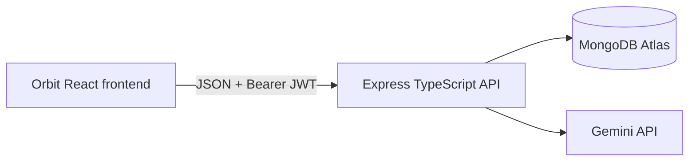

# Orbit

Orbit is a dating and social discovery web app that combines traditional
profile-based dating with an interaction-first **Explore** mode.

## Why Orbit

Traditional dating apps overemphasize instant profile judgment: photo, swipe,
decide. Orbit keeps that familiar path available, but leads with something
different — interaction before decision. Personality, humor, interests, and
communication style get a chance to matter before or alongside appearance.

## Explore Mode

Explore is Orbit's signature experience and the app's default landing page.
Instead of judging profiles, users respond to conversation prompts, opinions,
and interest-based topics inside **Circles** (Gaming, Music, Movies, Food,
Tech, Deep Talks, and more). Replying to someone's answer can turn into a
conversation, and if interest is mutual, a **Connection**. Explore is
designed to feel useful and entertaining on its own, not just as a funnel
toward a match.

## Discover Mode

Discover is the traditional dating experience: browse profiles, view photos,
bios, and interests, and send a **Signal** (a lightweight expression of
interest) or pass. It stays intentionally secondary to Explore in this
project.

## Core Features

- Explore prompts, organized into Circles
- Prompt detail pages with existing responses and a validated response form
- Signals and Connections
- Discover profile browsing
- Mobile-style web UI with a centered phone-shaped shell on desktop
- Dark mode
- Client-side routing with protected pages
- Typed Express API integration with JWT authentication and owner-scoped responses
- Protected Orbit Conversation Coach backed by server-side Gemini integration
- Form validation with React Hook Form + Zod

## Tech Stack

- TypeScript (strict mode)
- React + Vite
- Tailwind CSS
- React Router
- Zustand (with persisted auth state)
- TanStack Query
- Separate Express/TypeScript backend (see the companion `itelect4-backend` repository)
- MongoDB/Mongoose persistence and JWT auth
- React Hook Form + Zod
- shadcn/ui (Button, Input, Label)

## Project Structure

```text
itelect4-project/
├─ db.json                 # json-server data: profiles, prompts, responses, connections
├─ sample.ts                # Strict-TypeScript conversion of the provided sample.js (GT1)
├─ src/
│  ├─ api/client.ts          # Centralized fetch calls to the json-server API
│  ├─ components/            # Reusable Orbit components + shadcn/ui primitives
│  ├─ hooks/                 # useToggle, usePrevious
│  ├─ layouts/Layout.tsx      # Shared header + bottom nav + <Outlet />
│  ├─ pages/                 # LoginPage, ExplorePage, PromptDetailPage, DiscoverPage,
│  │                          # ConnectionsPage, ProfilePage, NotFoundPage
│  ├─ schemas/                # Zod schemas
│  ├─ stores/                 # Zustand stores (auth, ui)
│  ├─ types/index.ts           # Orbit domain + API types, generics, enums
│  ├─ App.tsx                 # Route table
│  ├─ main.tsx                 # App entry: providers + BrowserRouter
│  └─ index.ts                 # GT1 TypeScript foundation script (kept for evidence)
├─ tsconfig.json / tsconfig.app.json / tsconfig.node.json
├─ components.json           # shadcn/ui config
└─ vite.config.ts
```

## Setup

```bash
npm install
```

## Run

Configure the frontend API origin, then start the dev server:

```bash
Copy-Item .env.example .env
npm run dev
```

Set `VITE_API_URL` in `.env` to the backend API URL, for example
`http://localhost:4000/api`. Gemini credentials belong only in the backend.

## Architecture



To run the original GT1 TypeScript foundation script directly:

```bash
npm run start
```

## Build & type-check

```bash
npm run build
npm run typecheck
npm test
```

Both must complete with zero TypeScript errors.

The GT1-era `sample.ts` at the project root type-checks independently:

```bash
npm run typecheck:gt1
```

## Coursework submission

See [`docs/submission.md`](docs/submission.md) for the four primary links,
PRs, tags, CI workflows, verified commands, browser evidence, and remaining
provider configuration. The companion backend is
[`sebastianmeer/itelect4-backend`](https://github.com/sebastianmeer/itelect4-backend).

AI-use disclosure: AI tools assisted with implementation, testing,
documentation, and debugging. The project author reviewed the changes and
verified the recorded commands.
